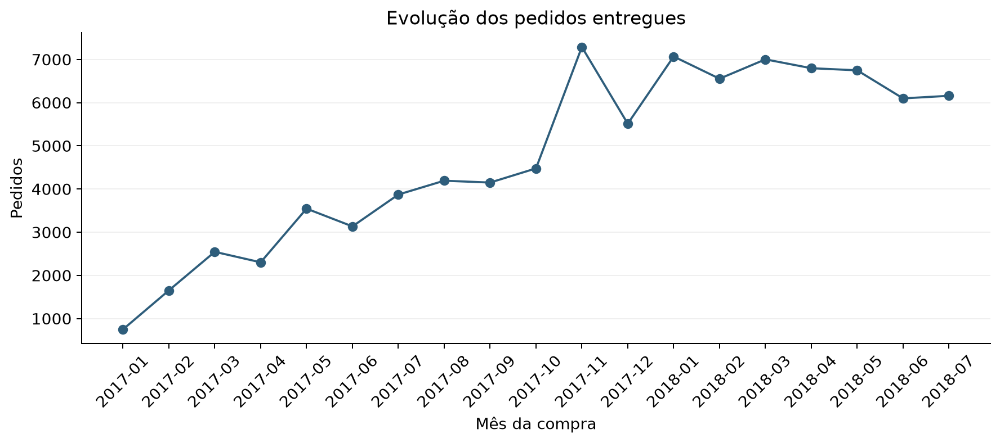
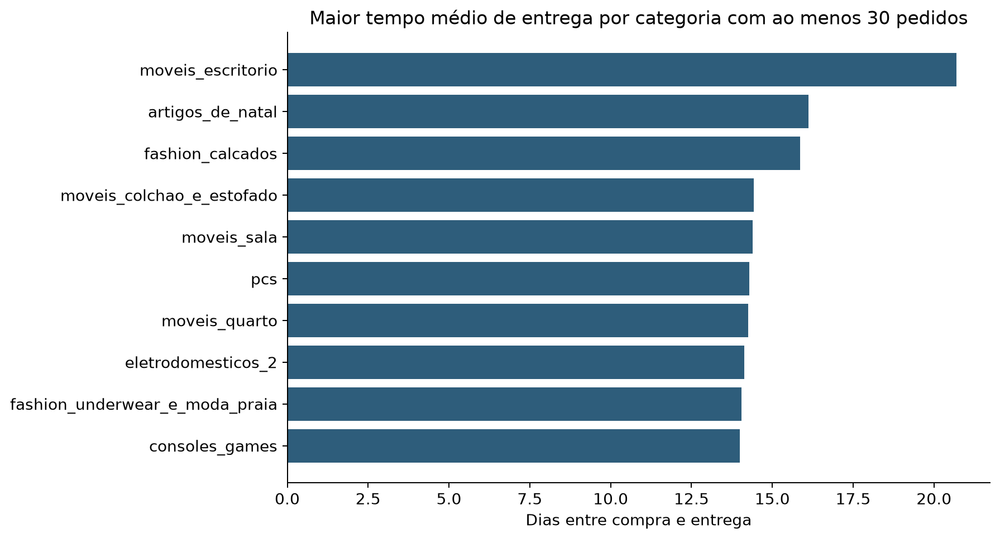

# Olist crescimento e qualidade da entrega

Relatório executivo do Tech Challenge Fase 1

## Síntese e problema de negócio

Propomos atualizar os indicadores operacionais e realizar um piloto de gestão do prazo de entrega antes de ampliar investimentos na operação. A análise histórica aponta crescimento principalmente em volume e maior frequência de avaliações baixas entre pedidos atrasados. A decisão de expansão depende de confirmar esse padrão em dados atuais e incorporar custos.

### Situação do case

O conjunto público da Olist representa transações de um marketplace com clientes, vendedores, produtos, pedidos e avaliações. Nesse ambiente, aumentar o volume comercial exige acompanhar a execução das entregas. Uma leitura baseada apenas no valor vendido não mostra quais regiões concentram ocorrências nem como a experiência dos clientes difere conforme o cumprimento do prazo.

### Problema de negócio

Como sustentar o crescimento dos pedidos entregues e priorizar ações de qualidade logística, considerando diferenças entre regiões, categorias e avaliações dos clientes? O público da análise é a gestão comercial e operacional, com uma síntese voltada também a investidores e acionistas.

A pergunta foi desdobrada em desempenho comercial, cumprimento do prazo, sinais de insatisfação e duração da entrega por categoria. A metodologia é descritiva e diagnóstica: os resultados indicam onde investigar e fundamentam uma proposta de teste, sem demonstrar causas isoladas.

| Indicador no recorte completo | Resultado |
|---|---:|
| Pedidos entregues | 89.860 |
| Clientes únicos | 86.960 |
| Itens vendidos | 102.738 |
| Valor dos itens sem frete | R$ 12.342.450,49 |
| Ticket médio sem frete | R$ 137,35 |

Fonte [3] Resumo executivo. Recorte de compras de 01/01/2017 a 31/07/2018 com status entregue. O valor dos itens não representa receita líquida ou lucro.

## Dados e estruturação da análise

Utilizamos os nove arquivos do Brazilian E-Commerce Public Dataset by Olist. O inventário registra contagens, ausências, duplicidades e identificação dos arquivos por hash. As fontes são mantidas intactas e os resultados são gerados em pastas próprias [1, 2].

| Fonte | Registros brutos | Uso no projeto |
|---|---:|---|
| Pedidos | 99.441 | Status e datas das etapas da compra |
| Clientes | 99.441 | Cliente único e UF de destino |
| Itens | 112.650 | Produto, vendedor, preço e frete |
| Produtos | 32.951 | Categoria e atributos do produto |
| Avaliações | 99.224 | Notas e sinais presentes nos comentários |
| Tradução de categorias | 71 | Padronização dos nomes de categorias |
| Pagamentos | 103.886 | Auditoria sem junção aos valores comerciais |
| Vendedores | 3.095 | Auditoria das referências de vendedor |
| Geolocalização | 1.000.163 | Auditoria sem integração ao modelo comercial |

Fonte [3] Inventário das fontes. A modelagem usa o identificador de vendedor já presente nos itens; não depende de unir seu cadastro.

### Recorte e desenho metodológico

Selecionamos pedidos com status `delivered` e compra entre 01/01/2017 e 31/07/2018, inclusive. O mês de referência é o da compra e a localização corresponde à UF do cliente. Para comparar anos, usamos janeiro a julho em ambos os períodos.

A estruturação partiu da decisão de negócio e seguiu para entendimento das fontes, tratamento, modelagem por item e por pedido, reconciliação dos valores e análise das evidências. A etapa final transforma os achados em uma hipótese de melhoria com critérios de avaliação.

O recorte comercial não mede todo o funil de vendas. Pedidos cancelados, indisponíveis e ainda não entregues ficam fora dos indicadores principais. A análise de prazo exige datas observáveis; a de notas considera somente pedidos avaliados em cada grupo.

## Processamento e confiabilidade dos resultados

O pipeline lê cada fonte uma única vez, audita as chaves e referências e trata as tabelas centrais. Datas inválidas permanecem como ausências. Categorias sem informação recebem um rótulo e suas vendas são preservadas. Preço e frete são convertidos em centavos com arredondamento decimal; valores inválidos, ausentes ou negativos interrompem a execução [2].

### Modelagem e prevenção de duplicação

| Base produzida | Granularidade | Registros |
|---|---|---:|
| Fato de itens | Uma linha por pedido e item | 112.650 |
| Fato de pedidos | Uma linha por pedido com itens | 98.666 |
| Entregas e avaliações | Uma linha por pedido elegível | 89.860 |

Fonte [2] Modelagem e execução do pipeline. As duas primeiras bases preservam pedidos fora do recorte por meio do indicador de elegibilidade; a terceira contém o recorte elegível.

As avaliações são agregadas por pedido antes da integração. Vários pagamentos ou avaliações não podem multiplicar o preço dos itens. Para duração por categoria, cada pedido aparece uma vez em cada categoria, ainda que contenha vários itens iguais. Um pedido com categorias diferentes participa de cada grupo e não deve ser somado novamente como total geral.

### Qualidade observada e controles

Os seis controles analíticos retornaram conformidade: chave única de item, chave única de pedido, reconciliação de preço, reconciliação de frete, contagem de pedidos e cobertura dos pedidos elegíveis da fonte. Os valores reconciliados foram R$ 12.342.450,49 em itens e R$ 2.045.177,88 em frete [3].

O inventário identificou 610 produtos sem categoria e 261.831 linhas integralmente duplicadas na geolocalização. As categorias ausentes foram preservadas com identificação explícita; a geolocalização não foi usada nos indicadores. Oito pedidos elegíveis não possuem ambas as datas necessárias para medir cumprimento do prazo.

O processo gera três bases analíticas, dez tabelas de indicadores e seis gráficos. Os testes automatizados protegem dinheiro, granularidade, limites de data e denominadores. O notebook consulta essas tabelas, mantendo uma única implementação das regras [2].

## Desempenho comercial

Entre janeiro e julho de 2018, os pedidos entregues cresceram 160,8% e o valor dos itens cresceu 161,6% em comparação aos mesmos meses de 2017. O ticket médio sem frete variou apenas 0,3%. A expansão observada acompanha principalmente o número de pedidos, o que aumenta a importância de acompanhar a capacidade de entrega [3].

| Janeiro a julho | Pedidos | Valor dos itens | Ticket sem frete |
|---|---:|---:|---:|
| 2017 | 17.805 | R$ 2.438.756,43 | R$ 136,97 |
| 2018 | 46.432 | R$ 6.379.548,48 | R$ 137,40 |
| Variação | 160,8% | 161,6% | 0,3% |

Fonte [3] Comparativo de janeiro a julho. O recorte completo inclui também agosto a dezembro de 2017.

### Concentração e interpretação

SP, RJ e MG concentram 63,0% do valor dos itens. As categorias saúde e beleza, relógios e presentes, cama mesa e banho e esporte e lazer somam 33,0%. Os dez vendedores de maior valor representam 13,6% do total [3].

Essa concentração indica onde começar a investigação operacional. Ela não demonstra que determinada região tenha maior margem ou potencial de mercado. O ticket médio de R$ 137,35 também supera a mediana de R$ 86,99; a distribuição é influenciada por pedidos de maior valor e recomenda olhar as duas medidas em conjunto.

## Prazo de entrega e experiência do cliente

Dos 89.852 pedidos com prazo observável, 6.138 chegaram após a data estimada, uma taxa de 6,8%. Consideramos atraso quando o dia da entrega efetiva é posterior ao dia previsto. Uma entrega no próprio dia previsto é considerada pontual [2, 3].

| Situação | Pedidos com prazo observável | Pedidos avaliados | Avaliados com nota 1 ou 2 |
|---|---:|---:|---:|
| No prazo | 83.714 | 83.237 | 9,4% |
| Atrasou | 6.138 | 5.993 | 63,7% |

Fonte [3] Entrega e avaliação. Cada pedido é contado uma vez; alguma nota 1 ou 2 o classifica como avaliação baixa. As notas médias por pedido foram 4,28 no grupo pontual e 2,23 no grupo atrasado.

A diferença entre os grupos sugere investigar a experiência logística. Outros fatores também podem influenciar as notas; a associação não estima o efeito causal do atraso sobre a satisfação.

### Diferenças regionais

| UF | Pedidos com prazo observável | Atrasados | Taxa de atraso | Possíveis reclamações |
|---|---:|---:|---:|---:|
| SP | 37.235 | 1.532 | 4,11% | 603 |
| RJ | 11.587 | 1.453 | 12,54% | 512 |
| MG | 10.619 | 507 | 4,77% | 210 |

Fonte [3] Logística por UF. A tabela apresenta as três UFs com maior volume de possíveis reclamações identificadas pela regra exploratória.

SP lidera em volume, mas RJ apresenta incidência de atraso superior e quase o mesmo número absoluto de entregas atrasadas. As taxas de possíveis reclamações são 1,62% em SP, 4,42% no RJ e 1,98% em MG, calculadas sobre todos os pedidos com prazo observável da UF.

Uma possível reclamação exige nota 1 ou 2 e expressão relacionada a demora na mesma avaliação. O sinal é agregado por pedido. A regra de palavras-chave não foi validada como classificador e pode produzir erros; reclamações e atraso observado são indicadores distintos.

## Duração por categoria e prioridades de investigação

Móveis de escritório apresentam o maior tempo médio de entrega no ranking com ao menos 30 pedidos válidos: 20,70 dias. Artigos de Natal e calçados aparecem em seguida. A duração é a diferença entre compra e entrega em dias fracionários, com exclusão de intervalos negativos ou ausentes [2, 3].

| Categoria | Pedidos | Média em dias | Mediana em dias | Taxa de atraso |
|---|---:|---:|---:|---:|
| Móveis de escritório | 1.224 | 20,70 | 18,86 | 8,09% |
| Artigos de Natal | 115 | 16,12 | 13,28 | 8,70% |
| Calçados | 231 | 15,87 | 14,19 | 4,76% |

Fonte [3] Tempo de entrega por categoria. Nomes apresentados em português a partir das categorias originais.

Tempo longo não implica descumprimento da promessa. Calçados têm duração média elevada e taxa de atraso inferior à taxa geral de 6,8%. As categorias também diferem em produto, região, vendedor e sazonalidade; os agregados não identificam uma causa.

Propomos investigar primeiro o RJ pela combinação de volume e incidência observados, e examinar móveis de escritório pela duração e quantidade de pedidos. A seleção definitiva do piloto deve cruzar esses recortes com dados recentes e detalhamento operacional. A análise agregada não demonstra que os mesmos pedidos concentrem todos esses fatores.

## Proposta de melhoria e avaliação

A proposta é um piloto de gestão da promessa de entrega. A hipótese é que identificar risco de atraso, tratar desvios com vendedores e transportadoras e melhorar a comunicação ao cliente possa reduzir descumprimentos e avaliações baixas. O benefício precisa ser testado; nenhum ganho financeiro foi estimado nesta base.

| Etapa proposta | Ação | Evidência para avançar |
|---|---|---|
| Diagnóstico | Atualizar dados e segmentar UF, categoria, vendedor e transportadora | Base recente validada e segmentos com volume suficiente |
| Preparação | Revisar promessas de prazo e motivos de desvio no segmento escolhido | Processo definido, responsável operacional e custos registrados |
| Piloto | Testar acompanhamento de pedidos em risco e comunicação de desvios | Intervenção registrada e grupo de comparação preservado |
| Avaliação | Comparar prazo, avaliações, volume e custo antes de ampliar | Melhoria consistente sem deterioração dos indicadores de proteção |

O desenho sugerido ocupa aproximadamente 90 dias, sujeito à disponibilidade de dados e ao ciclo de entrega: preparação no primeiro mês, intervenção no segundo e acompanhamento das entregas e avaliações no terceiro. Esse calendário é uma proposta de planejamento, não uma atividade já executada.

### Indicadores e critérios de decisão

O indicador principal é a taxa de atraso entre pedidos com prazo observável. Os indicadores complementares são a proporção de pedidos avaliados com nota 1 ou 2, a duração de entrega, o volume entregue e o custo operacional por pedido. Também é necessário acompanhar a cobertura das avaliações e os cancelamentos em dados operacionais atuais.

As metas quantitativas devem ser definidas após medir a linha de base recente. A comparação deve considerar grupos ou períodos equivalentes em UF, categoria e perfil operacional, além da sazonalidade. Sempre que viável, a alocação aleatória favorece a interpretação do efeito da intervenção.

Propomos ampliar somente após observar redução de atrasos com evidência de estabilidade, sem piora material de satisfação, cancelamentos ou custos. O tamanho de amostra e o período de acompanhamento devem ser definidos antes do teste. A decisão econômica exige custos, taxas e margem que não constam do dataset.

## Limites e rastreabilidade

### Alcance das conclusões

Os resultados descrevem compras históricas de 2017 e 2018 e não representam o desempenho atual da Olist. O filtro de entregues limita a leitura do funil e não permite concluir sobre todas as compras realizadas. Faltas de datas e avaliações alteram os universos usados em cada métrica e são tratadas explicitamente.

A triagem textual depende de linguagem, preenchimento dos comentários e interpretação de expressões. Ela não equivale a uma contagem oficial de reclamações nem a uma medida de NPS. Uma avaliação pode ter sido registrada antes da entrega; sua relação com o desfecho logístico exige análise temporal adicional.

As comparações entre estados e categorias são descritivas. O corte de 30 pedidos é um critério exploratório para o ranking de duração e não assegura significância estatística. A base não contém margem, custos logísticos completos ou taxas do marketplace para calcular retorno de investimento.

### Fontes e reprodução

[1] Brazilian E-Commerce Public Dataset by Olist. Nove arquivos CSV versionados na pasta `data/raw/` do repositório do projeto.

[2] Repositório Analise Olist. Código em `src/olist/`, execução em `scripts/run_pipeline.py`, testes em `tests/` e definições em `docs/metodologia.md`.

[3] Resultados do processamento. Inventário e validações em `reports/qualidade/`; resumo executivo, comparativo anual, distribuição, categorias, UFs, vendedores, entrega e avaliação, logística por UF e duração por categoria em `reports/tabelas/`.

Repositório e evidências: https://github.com/tauapatrick1989-rgb/Analise_Olist

Para reproduzir, use Python 3.12, instale `requirements.txt`, execute `python -m unittest discover -s tests` e depois `python scripts/run_pipeline.py`. O notebook apenas apresenta as tabelas geradas. Os gráficos usados neste relatório são produzidos pelo mesmo pipeline.

A contribuição da análise exploratória de atrasos e reclamações foi incorporada ao módulo de logística e mantida no notebook como roteiro de leitura. A proposta de melhoria é uma recomendação para teste; não constitui uma intervenção implementada nem um resultado comprovado.
